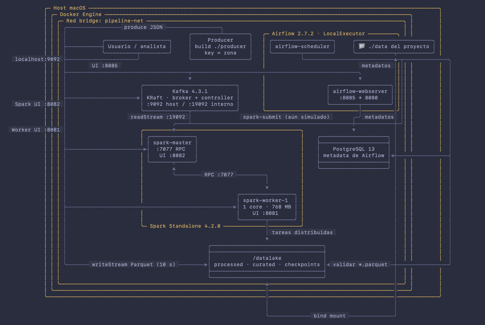
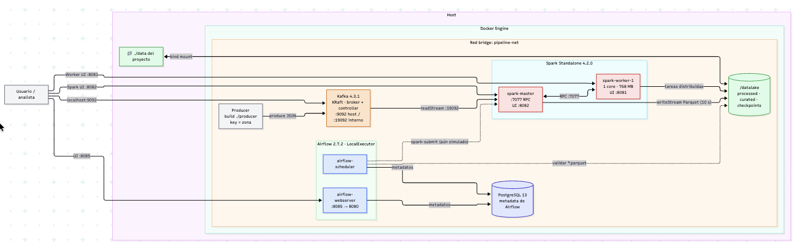
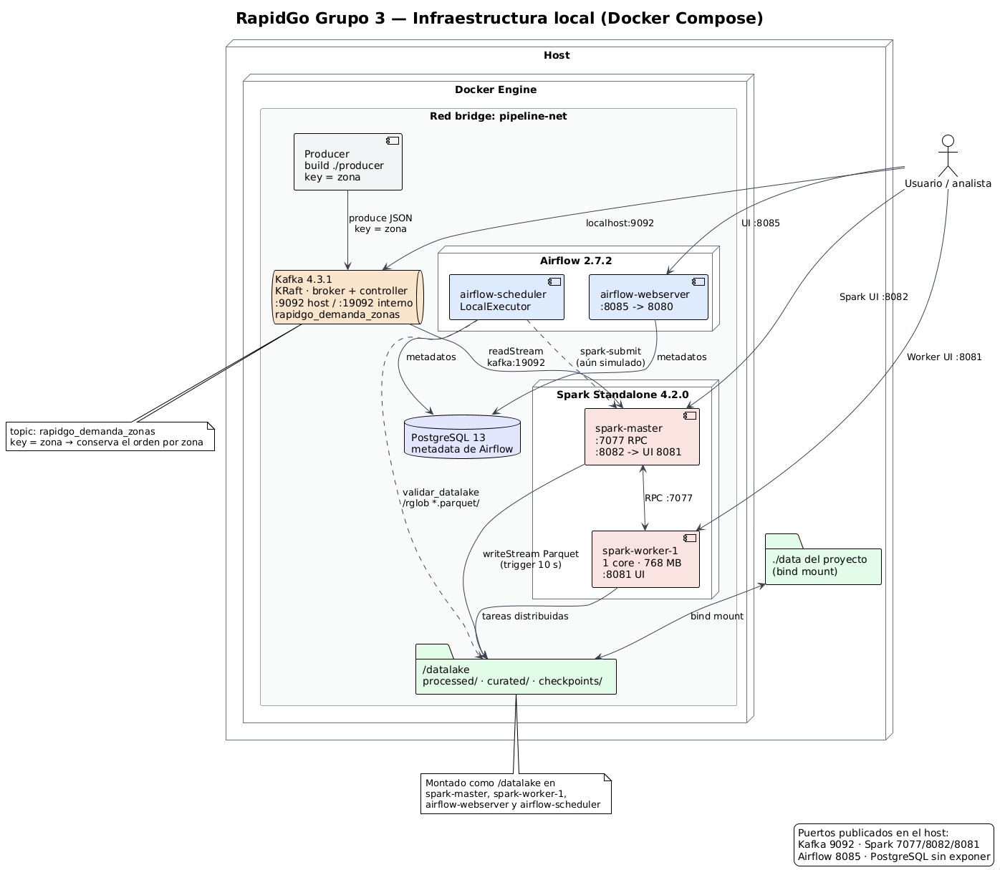

 

# RapidGo Grupo 3

### *Variante 5* **demanda por zonas**

> **Eventos:** zona, timestamp, categoria, estado
> **KPIs:** pedidos/minuto, zona caliente, franja
> **Alertas:** demanda alta / capacidad insuficiente

## Miembros del grupo

- Daniel Esteban Rivera Gomez
- Lusia Valentina Rodriguez Perez
- Shirley Dayana Perez Esquivel

## Problema de negocio

RapidGo es una plataforma de entregas que necesita una plataforma de datos capaz de capturar eventos operacionales, procesarlos, almacenarlos, generar indicadores y automatizar procesos de control. Todos los equipos trabajarán sobre la misma organización, pero resolverán problemas diferentes.

### Valor de la solución

Mmmmm

---

## Arquitectura de la solucion







## Tecnologias usadas

### Roles

## Prerequisitos

Para poder ejecutar esta solucion de forma local debes contar con las siguietenes herramientas para poder ejecutar el proyecto

- **Docker:** es una herramienta que permite empaquetar una aplicación junto con todo lo que necesita para funcionar dentro de una caja virtual llamada "contenedor"  Gracias a esto, un programa corre exactamente igual en cualquier computadora, sin importar si es Windows, Mac o Linux.  Si no lo tienes instalado pues obtenerlo en [docker](https://www.docker.com/)

  *Para comprobar si lo tienes instalado dirigete a la terminal de tu equipo y ejecuta*:

  ```shell
    docker --version
  ```

  esto mostrara por terminal algun mensaje como: `Docker version 27.x.x, build....`
- **Git:** es un sistema de control de versiones que permite descargar el código fuente del proyecto y gestionar todos sus cambios e historial de forma ordenada. Si no lo tienes instalado pues obtenerlo en [Git](https://git-scm.com)

  *Para comprobar si lo tienes instalado dirígete a la terminal de tu equipo y ejecuta*:

  ```shell
    git --version
  ```

  esto mostrará por terminal algún mensaje como: `git version 2.x.x...`

## Como ejecutar localmente

Para poder acceder y correr de forma local este flujo de trabajo puedes seguir los siguientes pasos de configuracion:

1. Dirigete a la carpeta donde deseas trabajar este proyecto `cd  /Users/user/documentos/`
2. Crea una carpeta para contener este proyecto `mkdir rapid_go`
3. Muevete a esta carpeta que haz creado `cd rapid_go`
4. Trae el proyecto a tu equipo local con el comando  `git clone https://github.com/drago668/RapidGo_Grupo_3.git` lo cual traera todo el contenido de este repositorio para que lo ejecutes
5. Una vez termine este proceso se creara la carpeta `RapidGo_Grupo_3` donde queda contenido todo el codigo, ahora entra a dicha carpeta con `cd  RapidGo_Grupo_3`
6. la estructura del protecto debe quedar tal que asi:

```bash
├── airflow
│   └── dags
│       └── rapid_go_dag.py
├── conftest.py
├── data
│   ├── curated
│   ├── processed
│   └── raw
├── datalake
│   └── README.md
├── docker-compose.yml
├── Dockerfile
├── docs
│   ├── checkpoints
│   │   ├── semana1.md
│   │   ├── semana2.md
│   │   └── semana3.md
│   ├── decisions
│   │   ├── ADR-001.md
│   │   ├── ADR-002.md
│   │   └── ADR-003.md
│   └── errors
│       ├── error1.md
│       ├── error2.md
│       ├── error3.md
│       └── image
│           └── error1
├── entrypoint.sh
├── producer
│   ├── __init__.py
│   ├── contrato.py
│   ├── Dockerfile
│   └── producer.py
├── README.md
├── requirements-dev.txt
├── requirements.txt
├── samples
│   └── example_event.json
├── spark
│   ├── __init__.py
│   ├── reglas.py
│   └── spark_stream.py
└── tests
    ├── test_contrato.py
    ├── test_producer.py
    └── test_reglas.py
```

7. docker compose up -d (con lo cual construiras toda la infraestructura del proyecto)
8. 


## Indicadores Clave de Rendimiento (KPIs) y Reglas de Alerta

* **Riesgo Principal:** Saturación y Déficit de Flota
* **Problema:** Picos masivos de solicitudes por zona que superan la capacidad de preparación en cocinas y la disponibilidad de repartidores, generando pedidos en estado `CREADO` sin asignar, incumplimiento de SLA y cancelaciones.

---

### 1. Definición de KPIs Mínimos


| KPI                                        | Métrica Técnica              | Ventana de Cálculo              | Unidad        | Objetivo Operacional                                                                                                                     |
| :------------------------------------------- | :------------------------------- | :--------------------------------- | :-------------- | :----------------------------------------------------------------------------------------------------------------------------------------- |
| **KPI 1: Tasa de Demanda por Zona**        | `kpi_pedidos_por_minuto`       | Deslizante de 5 min (paso 1 min) | `pedidos/min` | Monitorear el ritmo de entrada de órdenes en tiempo real para anticipar congestión en comercios y escasez de repartidores.             |
| **KPI 2: Concentración de Zona Caliente** | `kpi_share_demanda_zona`       | Fija (*tumbling*) de 15 min      | `% del total` | Detectar cuadrantes que absorben una porción desproporcionada de la demanda metropolitana para redistribuir la flota.                   |
| **KPI 3: Demanda por Franja y Categoría** | `kpi_demanda_franja_categoria` | Fija de 1 hora                   | `conteo`      | Segmentar el volumen de órdenes por horario (pico almuerzo, pico cena, valle) y tipo de comercio (Restaurante, Supermercado, Farmacia). |

#### Fórmulas de Cálculo (Procesamiento en Spark)

* **KPI 1 (Rendimiento):**

  $$
  \text{Throughput}(z, t) = \frac{\text{Conteo de pedidos en zona } z \text{ en la ventana } [t - 5\text{ min}, t]}{5\text{ minutos}}

  $$
* **KPI 2 (% Participación):**

  $$
  \ \text{ Demanda}(z) = \left( \frac{\text{Pedidos en Zona } z}{\sum_{k \in \text{Zonas}} \text{Pedidos en Zona } k} \right) \times 100

  $$
* **KPI 3 (Segmentación horaria):**

  $$
  \text{Volumen}(f, c) = \text{COUNT}(\text{pedidos}) \quad \forall \text{ timestamp} \in \text{Franja } f \land \text{categoría} = c

  $$

---

### 2. Reglas de Alerta Operacionales y Umbrales Iniciales


| Alerta                             | Evento Disparador                  | Umbral Inicial                                               | Nivel      | Acción Operativa Automatizada                                                                                                                            |
| :----------------------------------- | :----------------------------------- | :------------------------------------------------------------- | :----------- | :---------------------------------------------------------------------------------------------------------------------------------------------------------- |
| **ALERTA_DEMANDA_SUPERIOR_UMBRAL** | Picos de solicitudes por zona      | **Warning:** $> 35$ ped/min**Critical:** $> 50$ ped/min      | `CRITICAL` | 1. Activar tarifa dinámica (*surge pricing*) para regular la entrada de órdenes.2. Notificar a repartidores en zonas aledañas con incentivo por viaje. |
| **ALERTA_ZONA_SIN_CAPACIDAD**      | Acumulación de órdenes en espera | $> 80$ pedidos en estado `CREADO` sin asignar por $> 10$ min | `CRITICAL` | 1. Pausa preventiva de admisión de nuevos pedidos en la app para esa zona (*pause orders*).2. Rebalanceo forzado de la flota.                            |

#### Justificación Técnica y de Negocio de los Umbrales

* **Justificación Alerta 1 (Sobredemanda > 50 ped/min):**
  La capacidad promedio estimada de preparación de los comercios aliados en un radio de cobertura zonal es de 25 a 30 pedidos por minuto. Superar los 35 pedidos/minuto satura los tiempos de preparación en cocinas, y superar los 50 pedidos/minuto agota los repartidores disponibles en el cuadrante, elevando exponencialmente el tiempo de entrega.
* **Justificación Alerta 2 (Capacidad Insuficiente > 80 pedidos sin asignar por > 10 min):**
  Tener más de 80 pedidos sin chofer asignado durante más de 10 minutos garantiza que el tiempo total de entrega superará los 45 minutos (violando el SLA prometido de RapidGo). Esta alerta protege la reputación del servicio evitando cancelaciones masivas.

---

## Topics y Contrato de Eventos (Kafka)

* **Topic principal:** `rapidgo_demanda_zonas`
* **Clave de particionamiento:** `zona` (garantiza orden cronológico zonal y optimiza el cálculo de ventanas en Spark sin *shuffle*, según ADR-001).
* **Esquema del evento de pedido (JSON):**

```json
{
  "pedido_id": "PED-001",
  "zona": "ZONA_CENTRO",
  "timestamp": "2026-11-10 20:15:30",
  "categoria": "restaurante",
  "estado": "CREADO"
}
```

---

## Cómo Ejecutar Pruebas y GitHub Actions

### 1. Pruebas Locales
Para verificar la calidad del código y la configuración antes de hacer push:

```bash
# 1. Instalar dependencias
pip install -r requirements.txt

# 2. Validar sintaxis en todo el proyecto
python -m compileall producer spark tests

# 3. Ejecutar pruebas unitarias de reglas y umbrales
python -m pytest -v

# 4. Validar sintaxis del archivo Docker Compose
docker compose config --quiet
```

### 2. Integración Continua (GitHub Actions)
* **Automática:** Cada `push` o `Pull Request` hacia la rama principal ejecuta el workflow `ci.yml`, asegurando que no se integre código roto ni fallen las pruebas de umbrales.
* **Manual (`workflow_dispatch`):** 
  1. Ve al repositorio en GitHub y haz clic en la pestaña **Actions**.
  2. Selecciona el workflow a la izquierda .
  3. Haz clic en el botón desplegable **Run workflow** y confirma en **Run workflow**.

---

## Cómo Acceder a Airflow y Ejecutar el DAG

1. **Asegurar que los contenedores estén corriendo:**
   ```bash
   docker compose up -d
   ```
2. **Acceder a la interfaz web:**
   * Abre tu navegador en: [http://localhost:8085](http://localhost:8085)
   * **Usuario:** `admin`
   * **Contraseña:** `admin`
3. **Ejecutar el DAG:**
   * En el listado de DAGs, busca **`rapid_go_dag`**.
   * Asegúrate de que el interruptor (toggle) a la izquierda esté en **ON** (azul).
   * En la columna de acciones a la derecha, haz clic en el botón **Trigger DAG** (botón de **Play**).
4. **Monitoreo y Trazabilidad:**
   * Haz clic sobre el nombre del DAG y entra a la pestaña **Graph** para ver las 12 tareas ejecutándose en paralelo y secuencia.
   * Para consultar los datos compartidos por XCom: ve al menú superior **Admin $\rightarrow$ XComs** para ver las métricas consolidadas (`total_pedidos_criticos`, `resumen_zonas_calientes`).
