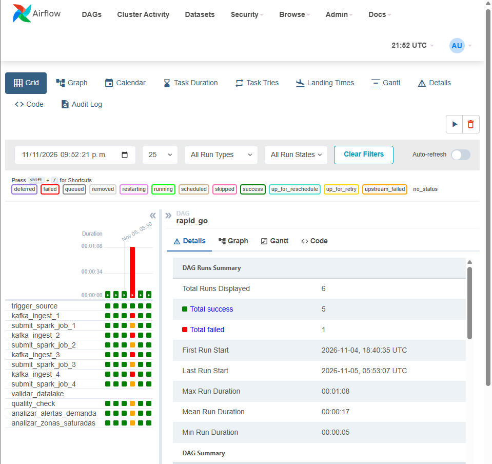
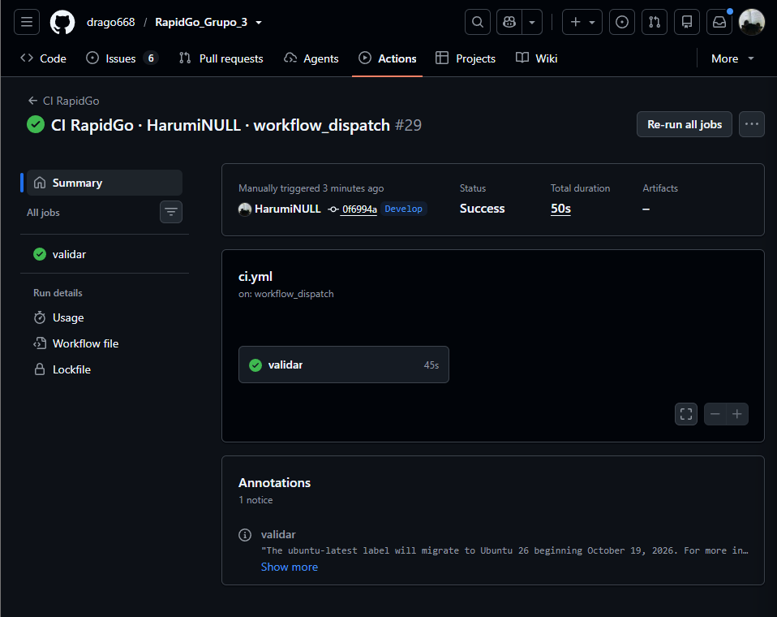

# RapidGo Grupo 3

## Índice

- [Variante 5: demanda por zonas](#variante-5-demanda-por-zonas)
- [Miembros del grupo](#miembros-del-grupo)
- [Problema de negocio](#problema-de-negocio)
  - [Valor de la solución](#valor-de-la-solución)
- [Arquitectura de la solución](#arquitectura-de-la-solucion)
- [Tecnologías usadas](#tecnologias-usadas)
  - [Roles](#roles)
- [Prerrequisitos](#prerrequisitos)
- [Cómo ejecutar localmente](#como-ejecutar-localmente)
- [Indicadores Clave de Rendimiento (KPIs) y Reglas de Alerta](#indicadores-clave-de-rendimiento-kpis-y-reglas-de-alerta)
  - [1. Definición de KPIs Mínimos](#1-definición-de-kpis-mínimos)
  - [Fórmulas de Cálculo (Procesamiento en Spark)](#fórmulas-de-cálculo-procesamiento-en-spark)
  - [2. Reglas de Alerta Operacionales y Umbrales Iniciales](#2-reglas-de-alerta-operacionales-y-umbrales-iniciales)
  - [Justificación Técnica y de Negocio de los Umbrales](#justificación-técnica-y-de-negocio-de-los-umbrales)
- [Topics y Contrato de Eventos (Kafka)](#topics-y-contrato-de-eventos-kafka)
- [Cómo Ejecutar Pruebas y GitHub Actions](#cómo-ejecutar-pruebas-y-github-actions)
  - [1. Pruebas Locales](#1-pruebas-locales)
  - [2. Integración Continua (GitHub Actions)](#2-integración-continua-github-actions)
- [Cómo Acceder a Airflow y Ejecutar el DAG](#cómo-acceder-a-airflow-y-ejecutar-el-dag)
- [Resultados](#resultados)
  - [Pipeline Integrado](#pipeline-integrado)
  - [Control de Demanda y Zonas](#control-de-demanda-y-zonas)
  - [Resiliencia y Pruebas](#resiliencia-y-pruebas)
  - [Evidencia](#evidencia)
- [Limitaciones y trabajo futuro](#limitaciones-y-trabajo-futuro)
  - [Limitaciones](#limitaciones)
  - [Trabajo futuro](#trabajo-futuro)
- [Tabla de Contribuciones](#tabla-de-contribuciones)

### *Variante 5* **demanda por zonas**

> **Eventos:** zona, timestamp, categoria, estado\
> **KPIs:** pedidos/minuto, zona caliente, franja\
> **Alertas:** demanda alta / capacidad insuficiente

## Miembros del grupo

- Daniel Esteban Rivera Gomez
- Lusia Valentina Rodriguez Perez
- Shirley Dayana Perez Esquivel

## Problema de negocio

RapidGo es una plataforma de entregas que conecta comercios, repartidores y clientes en distintas zonas de la ciudad. La demanda no es pareja: en las horas pico, algunas zonas reciben muchos más pedidos de los que sus cocinas y repartidores pueden atender.

El problema es que hoy la empresa se entera de esos picos cuando ya ocurrieron. La información llega al día siguiente, así que las decisiones se toman a mano y con experiencia, mientras unos repartidores quedan sin trabajo y a otros no les alcanza el tiempo para cubrir la demanda.

En concreto, hoy no es posible:

- Saber en el momento qué zona está recibiendo demasiados pedidos.
- Recibir un aviso cuando la capacidad de una zona se está quedando corta.
- Repartir la flota con datos, en lugar de hacerlo por intuición.
- Evitar que el cliente espere de más o cancele por falta de repartidor.

El proyecto busca cubrir esa necesidad con información actualizada al minuto: ver la demanda por zona, avisar al equipo de logística cuando una zona se esté saturando y apoyar decisiones sencillas como mover repartidores o activar tarifa dinámica. Nos enfocamos en la Variante 5 (demanda por zonas), donde cada pedido aporta su zona, la hora, la categoría del comercio y su estado.

### Valor de la solución

El pipeline convierte eventos de pedidos dispersos en decisiones operativas en
casi tiempo real. Aporta valor en tres frentes:

- **Operativo:** detecta zonas que superan 35 ped/min (warning) o 50 ped/min (critical) y activa *surge pricing* y rebalanceo de flota antes de que se incumpla el SLA de 45 minutos.
- **Analítico:** el Data Lake en Parquet conserva eventos (`processed/`) y KPIs (`curated/`), habilitando análisis histórico de demanda por franja y categoría.
- **Automatización:** Airflow orquesta el control de calidad y consolida resultados vía XCom, sin intervención manual.


| Dolor actual                 | Cómo lo ataca la solución                  | Evidencia                |
| :----------------------------- | :--------------------------------------------- | :------------------------- |
| Pedidos `CREADO` sin asignar | Regla de capacidad > 80 pedidos por > 10 min | `spark/reglas.py`, `spark/spark_stream.py` |
| Picos no anticipados         | KPIs de ventana deslizante de 5 min          | `kpi_pedidos_por_minuto` |

## Arquitectura de la solucion

1. `producer/` publica eventos JSON al topic `rapidgo_demanda_zonas` (key = zona).
2. Kafka (KRaft, 9092/19092) retiene y particiona por zona.
3. Spark Structured Streaming consume, aplica watermark y calcula KPIs en ventanas.
4. Resultados en Parquet: `data/processed/` (eventos) y `data/curated/` (KPIs/alertas).
5. Airflow ejecuta las 4 ramas del DAG y expone métricas por XCom.




## Tecnologias usadas


| Capa                 | Tecnología                                                    | Versión                   | Uso en el proyecto                                                                                                            |
| :--------------------- | :---------------------------------------------------------------- | :---------------------------- | :------------------------------------------------------------------------------------------------------------------------------ |
| Contenedores         | Docker + Docker Compose                                         | Compose v2                  | Orquesta los 7 servicios, la red `pipeline-net`, los volúmenes y los healthchecks.                                          |
| Mensajería         | Apache Kafka (KRaft)                                            | 4.3.1                       | Bus de eventos. Topic `rapidgo_demanda_zonas`, key `zona`, listeners `9092` (host), `19092` (interno) y `29093` (controller). |
| Procesamiento        | Apache Spark + Structured Streaming                             | 4.2.0                       | Master + 1 worker (1 core, 768 MB). Ventanas deslizantes/fijas, watermarks y escritura en Parquet.                            |
| Orquestación       | Apache Airflow                                                  | 2.7.2                       | `LocalExecutor`; webserver en `8085`; DAG `rapid_go` con 4 ramas paralelas, reintentos y XCom.                                |
| Metadatos            | PostgreSQL                                                      | 13                          | Base de datos de Airflow (`airflow`), con healthcheck `pg_isready`.                                                           |
| Lenguaje             | Python                                                          | 3.12 (producer) / 3.13 (CI) | Generación de eventos y ejecución de pruebas.                                                                             |
| Cliente Kafka        | kafka-python-ng (contenedor) / kafka-python 3.0.12 (local y CI) | —                          | Publicación de eventos y pruebas del producer.                                                                              |
| API de Spark         | PySpark                                                         | 4.2.0                       | Dependencia local alineada con la versión del clúster.                                                                    |
| Almacenamiento       | Apache Parquet                                                  | —                          | Data Lake en `processed/` (eventos) y `curated/` (KPIs y alertas).                                                            |
| Pruebas              | pytest                                                          | —                          | 33 pruebas del contrato, reglas de alerta y producer.                                                                         |
| CI                   | GitHub Actions                                                  | —                          | `compileall`, `pytest` y `docker compose config` en `main` y `Develop`.                                                       |
| Diagramas            | PlantUML + Mermaid                                              | —                          | Diagramas de infraestructura y flujo de datos.                                                                                |
| Control de versiones | Git + GitHub                                                    | —                          | Ramas, PR, issues, releases y ADR.                                                                                            |

### Roles


| Rol                        | Integrante                      | Responsabilidad principal         | Entregable                                             |
| :--------------------------- | :-------------------------------- | :---------------------------------- | :------------------------------------------------------- |
| Infraestructura y CI/CD    | Daniel Esteban Rivera Gomez     | Docker, GitHub Actions, DAG base  | `docker-compose.yml`, `.github/workflows/ci.yml`       |
| Ingesta y orquestación    | Luisa Valentina Rodriguez Perez | Producer Kafka, reintentos y XCom | `producer/producer.py`, `airflow/dags/rapid_go_dag.py` |
| Procesamiento y analítica | Shirley Dayana Perez Esquivel   | Spark Streaming, KPIs y reglas    | `spark/spark_stream.py`, `spark/reglas.py`             |

Las tres personas comparten la responsabilidad sobre pruebas (`tests/`) y la
documentación de errores controlados (`docs/errors/`).

## Prerequisitos

Para poder ejecutar esta solucion de forma local debes contar con las siguietenes herramientas para poder ejecutar el proyecto

- **Docker:** es una herramienta que permite empaquetar una aplicación junto con todo lo que necesita para funcionar dentro de una caja virtual llamada "contenedor"  Gracias a esto, un programa corre exactamente igual en cualquier computadora, sin importar si es Windows, Mac o Linux.  Si no lo tienes instalado pues obtenerlo en [docker](https://www.docker.com/)

  *Para comprobar si lo tienes instalado dirigete a la terminal de tu equipo y ejecuta*:

  ```shell
    docker --version
  ```

  esto mostrara por terminal algun mensaje como: `Docker version 27.x.x, build....`
- **Git:** es un sistema de control de versiones que permite descargar el código fuente del proyecto y gestionar todos sus cambios e historial de forma ordenada. Si no lo tienes instalado pues obtenerlo en [Git](https://git-scm.com)

  *Para comprobar si lo tienes instalado dirígete a la terminal de tu equipo y ejecuta*:

  ```shell
    git --version
  ```

  esto mostrará por terminal algún mensaje como: `git version 2.x.x...`
- Puertos libres: 9092, 7077, 8081, 8082, 8085.
- Recomendado: 8 GB de RAM para Docker.
- Opcional para pruebas: Python 3.12 o 3.13.

## Como ejecutar localmente

Para poder acceder y correr de forma local este flujo de trabajo puedes seguir los siguientes pasos de configuracion:

1. Dirigete a la carpeta donde deseas trabajar este proyecto `cd  /Users/user/documentos/`
2. Crea una carpeta para contener este proyecto `mkdir rapid_go`
3. Muevete a esta carpeta que haz creado `cd rapid_go`
4. Trae el proyecto a tu equipo local con el comando  `git clone https://github.com/drago668/RapidGo_Grupo_3.git` lo cual traera todo el contenido de este repositorio para que lo ejecutes
5. Una vez termine este proceso se creara la carpeta `RapidGo_Grupo_3` donde queda contenido todo el codigo, ahora entra a dicha carpeta con `cd  RapidGo_Grupo_3`
6. la estructura del protecto debe quedar tal que asi:

```bash
├── airflow
│   └── dags
│       └── rapid_go_dag.py
├── conftest.py
├── data
│   ├── curated
│   ├── processed
│   └── raw
├── datalake
│   └── README.md
├── docker-compose.yml
├── Dockerfile
├── docs
│   ├── checkpoints
│   │   ├── semana1.md
│   │   ├── semana2.md
│   │   └── semana3.md
│   ├── decisions
│   │   ├── ADR-001.md
│   │   ├── ADR-002.md
│   │   └── ADR-003.md
│   └── errors
│       ├── error1.md
│       ├── error2.md
│       ├── error3.md
│       └── image
│           └── error1
├── entrypoint.sh
├── producer
│   ├── __init__.py
│   ├── contrato.py
│   ├── Dockerfile
│   └── producer.py
├── README.md
├── requirements-dev.txt
├── requirements.txt
├── samples
│   └── example_event.json
├── spark
│   ├── __init__.py
│   ├── reglas.py
│   └── spark_stream.py
└── tests
    ├── test_contrato.py
    ├── test_producer.py
    └── test_reglas.py
```

7. docker compose up -d (con lo cual construiras toda la infraestructura del proyecto)

## Indicadores Clave de Rendimiento (KPIs) y Reglas de Alerta

* **Riesgo Principal:** Saturación y Déficit de Flota
* **Problema:** Picos masivos de solicitudes por zona que superan la capacidad de preparación en cocinas y la disponibilidad de repartidores, generando pedidos en estado `CREADO` sin asignar, incumplimiento de SLA y cancelaciones.

---

### 1. Definición de KPIs Mínimos


| KPI                                        | Métrica Técnica              | Ventana de Cálculo              | Unidad        | Objetivo Operacional                                                                                                                     |
| :------------------------------------------- | :------------------------------- | :--------------------------------- | :-------------- | :----------------------------------------------------------------------------------------------------------------------------------------- |
| **KPI 1: Tasa de Demanda por Zona**        | `kpi_pedidos_por_minuto`       | Deslizante de 5 min (paso 1 min) | `pedidos/min` | Monitorear el ritmo de entrada de órdenes en tiempo real para anticipar congestión en comercios y escasez de repartidores.             |
| **KPI 2: Concentración de Zona Caliente** | `kpi_share_demanda_zona`       | Fija (*tumbling*) de 15 min      | `% del total` | Detectar cuadrantes que absorben una porción desproporcionada de la demanda metropolitana para redistribuir la flota.                   |
| **KPI 3: Demanda por Franja y Categoría** | `kpi_demanda_franja_categoria` | Fija de 1 hora                   | `conteo`      | Segmentar el volumen de órdenes por horario (pico almuerzo, pico cena, valle) y tipo de comercio (Restaurante, Supermercado, Farmacia). |

#### Fórmulas de Cálculo (Procesamiento en Spark)

* **KPI 1 (Rendimiento):**

  $$\text{Throughput}(z, t) = \frac{\text{Conteo de pedidos en zona } z \text{ en la ventana } [t - 5\text{ min}, t]}{5\text{ minutos}}$$
* **KPI 2 (% Participación):**

  $$\text{Demanda}(z) = \left( \frac{\text{Pedidos en Zona } z}{\sum_{k \in \text{Zonas}} \text{Pedidos en Zona } k} \right) \times 100$$
* **KPI 3 (Segmentación horaria):**

  $$\text{Volumen}(f, c) = \text{COUNT}(\text{pedidos}) \quad \forall \text{ timestamp} \in \text{Franja } f \land \text{categoría} = c$$

---

### 2. Reglas de Alerta Operacionales y Umbrales Iniciales


| Alerta                             | Evento Disparador                  | Umbral Inicial                                               | Nivel      | Acción Operativa Automatizada                                                                                                                            |
| :----------------------------------- | :----------------------------------- | :------------------------------------------------------------- | :----------- | :---------------------------------------------------------------------------------------------------------------------------------------------------------- |
| **ALERTA_DEMANDA_SUPERIOR_UMBRAL** | Picos de solicitudes por zona      | **Warning:** $> 35$ ped/min**Critical:** $> 50$ ped/min      | `CRITICAL` | 1. Activar tarifa dinámica (*surge pricing*) para regular la entrada de órdenes.2. Notificar a repartidores en zonas aledañas con incentivo por viaje. |
| **ALERTA_ZONA_SIN_CAPACIDAD**      | Acumulación de órdenes en espera | $> 80$ pedidos en estado `CREADO` sin asignar por $> 10$ min | `CRITICAL` | 1. Pausa preventiva de admisión de nuevos pedidos en la app para esa zona (*pause orders*).2. Rebalanceo forzado de la flota.                            |

#### Justificación Técnica y de Negocio de los Umbrales

* **Justificación Alerta 1 (Sobredemanda > 50 ped/min):**
  La capacidad promedio estimada de preparación de los comercios aliados en un radio de cobertura zonal es de 25 a 30 pedidos por minuto. Superar los 35 pedidos/minuto satura los tiempos de preparación en cocinas, y superar los 50 pedidos/minuto agota los repartidores disponibles en el cuadrante, elevando exponencialmente el tiempo de entrega.
* **Justificación Alerta 2 (Capacidad Insuficiente > 80 pedidos sin asignar por > 10 min):**
  Tener más de 80 pedidos sin chofer asignado durante más de 10 minutos garantiza que el tiempo total de entrega superará los 45 minutos (violando el SLA prometido de RapidGo). Esta alerta protege la reputación del servicio evitando cancelaciones masivas.

---

## Topics y Contrato de Eventos (Kafka)

* **Topic principal:** `rapidgo_demanda_zonas`
* **Clave de particionamiento:** `zona` (garantiza orden cronológico zonal y optimiza el cálculo de ventanas en Spark sin *shuffle*, según ADR-001).
* **Esquema del evento de pedido (JSON):**

```json
{
  "pedido_id": "PED-001",
  "zona": "ZONA_CENTRO",
  "timestamp": "2026-11-10 20:15:30",
  "categoria": "restaurante",
  "estado": "CREADO"
}
```

---

## Cómo Ejecutar Pruebas y GitHub Actions

### 1. Pruebas Locales

Para verificar la calidad del código y la configuración antes de hacer push:

```bash
# 1. Instalar dependencias
pip install -r requirements.txt

# 2. Validar sintaxis en todo el proyecto
python -m compileall producer spark tests

# 3. Ejecutar pruebas unitarias de reglas y umbrales
python -m pytest -v

# 4. Validar sintaxis del archivo Docker Compose
docker compose config --quiet
```

### 2. Integración Continua (GitHub Actions)

* **Automática:** Cada `push` o `Pull Request` hacia la rama principal ejecuta el workflow `ci.yml`, asegurando que no se integre código roto ni fallen las pruebas de umbrales.
* **Manual (`workflow_dispatch`):**
  1. Ve al repositorio en GitHub y haz clic en la pestaña **Actions**.
  2. Selecciona el workflow a la izquierda .
  3. Haz clic en el botón desplegable **Run workflow** y confirma en **Run workflow**.

---

## Cómo Acceder a Airflow y Ejecutar el DAG

1. **Asegurar que los contenedores estén corriendo:**
   ```bash
   docker compose up -d
   ```
2. **Acceder a la interfaz web:**
   * Abre tu navegador en: [http://localhost:8085](http://localhost:8085)
   * **Usuario:** `admin`
   * **Contraseña:** `admin`
3. **Ejecutar el DAG:**
   * En el listado de DAGs, busca **`rapid_go_dag`**.
   * Asegúrate de que el interruptor (toggle) a la izquierda esté en **ON** (azul).
   * En la columna de acciones a la derecha, haz clic en el botón **Trigger DAG** (botón de **Play**).
4. **Monitoreo y Trazabilidad:**
   * Haz clic sobre el nombre del DAG y entra a la pestaña **Graph** para ver las 12 tareas ejecutándose en paralelo y secuencia.
   * Para consultar los datos compartidos por XCom: ve al menú superior **Admin $\rightarrow$ XComs** para ver las métricas consolidadas (`total_pedidos_criticos`, `resumen_zonas_calientes`).

## Resultados

### Pipeline Integrado

  Se logró la ejecución completa del sistema, transportando eventos de pedidos desde kafka, procesándolos mediante Spark Structured Streaming, almacenándolos en capas en el Data Lake y controlando su ejecución con Apache Airflow.

### Control de Demanda y Zonas

 El sistema procesa correctamente las cuatro ramas paralelas, permitiendo identificar zonas calientes y calcular métricas de pedidos críticos mediante el uso de XCom y tareas de control de calidad.

### Resiliencia y Pruebas

Se implementaron pruebas automatizadas con pytest y flujos de Integración Continua en GitHub Actions que validan la sintaxis y la integridad del DAG de Airflow ante fallos controlados de infraestructura.

### Evidencia

 **Pipeline en ejecución:** los 7 contenedores levantados y el DAG `rapid_go` completando sus tareas



**CI en verde:** `compileall`, `pytest` y `docker compose config` validados por GitHub Actions.



## Limitaciones y trabajo futuro

### Limitaciones:

Los umbrales para detectar zonas calientes y picos de demanda están configurados de manera estática en las reglas del negocio, lo que significa que no se adaptan automáticamente a cambios estacionales o tendencias imprevistas del mercado.

El pipeline procesa volúmenes de datos simulados a través de micro-lotes controlados, por lo que no se evaluó su comportamiento bajo condiciones de tráfico masivo concurrente en tiempo real continuo.

### Trabajo futuro

Integrar modelos de Machine Learning o análisis predictivo de series temporales para anticipar los picos de demanda por zonas en lugar de reaccionar únicamente cuando el umbral ya fue superado.

Conectar el sistema a una infraestructura de producción real en la nube y habilitar canales de notificación automáticos (como alertas por Webhook, Slack o correo) para el equipo de logística cuando una zona entre en estado crítico.

## Tabla de Contribuciones


| Integrante | Responsabilidades Principales | Issues Clave | PRs Principales |
| :--- | :--- | :--- | :--- |
| **Daniel Esteban Rivera Gomez** | • Configuración inicial (docker, entorno virtual y estructura base).<br />• Creación del GitHub Actions.<br />• Creación del DAG en Airflow y las tareas iniciales.<br />• Implementación del error 1 controlado. | • `#1` (Arquitectura)<br />• `#7` (Creación GitHub Actions)<br />• `#25` (test: Provocar y observar un fallo controlado en el pipeline) | • **PR #19** (validar sintaxis, pruebas)<br />• **PR #28** (Creación de tareas en el DAG) |
| **Luisa Valentina Rodriguez Perez** | • Integración del producer.<br />• Configuración de política de reintentos en el DAG.<br />• Implementación del error 3 controlado. | • `#4` (Desarrollo del Producer)<br />• `#24` (Implementar paso de metadatos con XCom usando contrato JSON)<br />• `#25` (test: Provocar y observar un fallo controlado en el pipeline) | • **PR #17** (Creación del Producer y su acoplamiento)<br />• **PR #29** (Implementación de XCom y de la política de reintento justificado) |
| **Shirley Dayana Perez Esquivel** | • Desarrollo del Spark.<br />• Desarrollo de las tareas en paralelo en el DAG.<br />• Implementación del error 2 controlado. | • `#5` (Construcción del script de Spark)<br />• `#6` (Implementación para calcular KPIs)<br />• `#23` (Definir dependencias y flujo en paralelo) | • **PR #16** (Spark streaming)<br />• **PR #13** (adr 001) |
