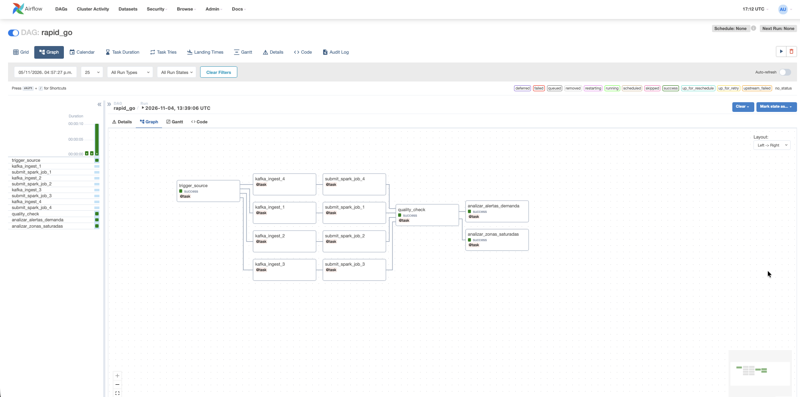
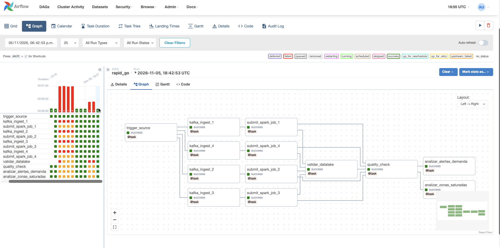

# Error 1 -- Validación del datalake vacío

> *Fecha:* 2026-11-05
> *Responsable:* Esteban Rivera
> *Objetivo:* Documentar el fallo controlado cuando el datalake no tiene datos.

## Descripción

Se agregó al DAG una tarea llamada `validar_datalake`, que revisa si hay archivos Parquet en `/datalake/processed` antes de continuar con el resto del pipeline.

Para probar el fallo se dejó vacía la carpeta del datalake. La validación detectó que no había archivos, falló y detuvo las tareas siguientes. Después se agregó un archivo de prueba y el DAG terminó correctamente.

## Evidencias

### 1. Antes de implementar la validación

El DAG no tenía la tarea `validar_datalake` y todas las tareas terminaban en `success`.

### 2. Fallo controlado con el datalake vacío

Sin archivos en el datalake, `validar_datalake` falla y las tareas posteriores quedan en `upstream_failed`.

### 3. Validación funcionando correctamente

Al agregar un archivo Parquet de prueba, `validar_datalake` pasa y el DAG termina en `success`.

## Conclusiones

- La validación evita que el pipeline continúe si el datalake está vacío.
- El fallo controlado confirma que el DAG se detiene correctamente.
- El archivo de prueba solo se usó para la demostración; no representa datos reales.
