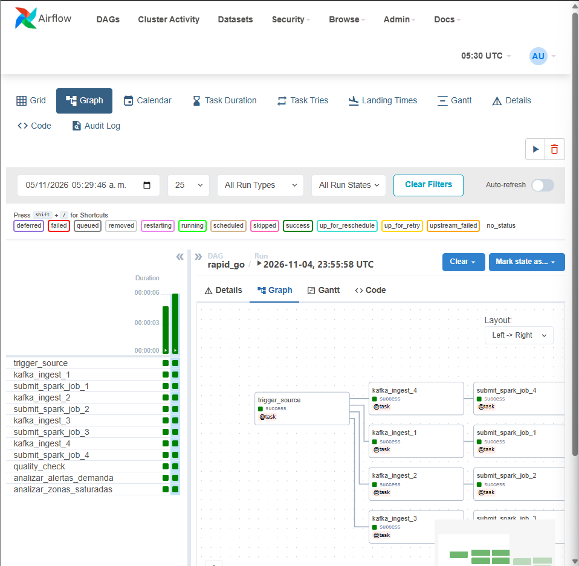
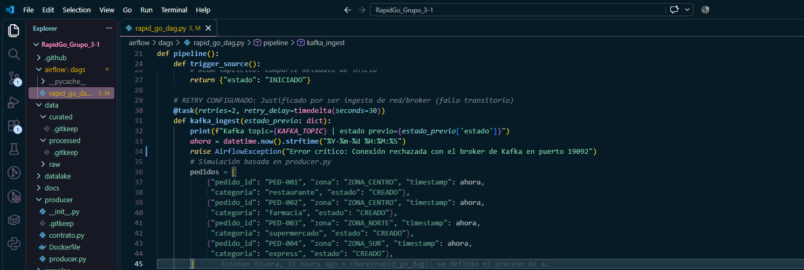
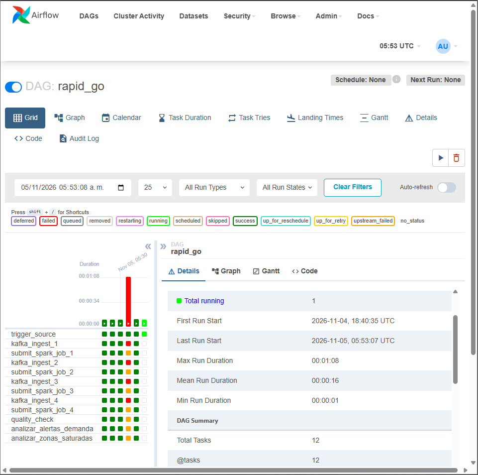

# Error n -- titulo del error

> *Fecha:* 2026-11-05
> *Responsable:* Shirley Perez
> *Objetivo:* Documentar el fallo controlado de cuando el contenedor kafka falla 

## Descripcion 
Se simuló un fallo  de conexión con el contenedor de kafka agregando un error controlado directamente dentro de la tarea encargada de recibir los datos `kafka_ingest`. 

Para comprobar si el programa sabía reaccionar ante fallos, se le configuró para que intentara repetir la tarea hasta 2 veces, esperando 30 segundos entre cada intento. Al ejecutar el sistema, este detectó el problema, mostró los avisos de que estaba reintentando y, al ver que no se solucionaba, marcó la tarea como fallida. Luego, al quitar el error y volver a correr el programa, el flujo completo terminó con éxito.

## Evidencias
### 1. Ejecución exitosa previa al experimento 
El DAG opera con normalidad y todas las tareas finalizaban en `success`.

### 2. Fallo controlado y aplicación 
Al interrumpir el servicio de kafka , Airflow reflejó el fallo de conexión y los estados de reintento en el panel de Airflow. 

### 3. Recuperación del flujo 
Tras volver a encender el contenedor eliminando el error antes puesto las tareas validaron la disponibilidad del servicio y concluyeron en `success`.

## Conclusiones
- El programa sabe reaccionar ante problemas temporales, dándose la oportunidad de repetir la tarea automáticamente antes de darse por vencido.

- La plataforma nos muestra de forma muy clara, mediante colores como el amarillo de los reintentos y el rojo cuando falla del todo, qué está pasando en cada momento.

- Al restablecerce la conexión con el contenedor se pudo observar como el sistema es capaz de recuperarse por si solo y terminar todo el proceso con éxito. 