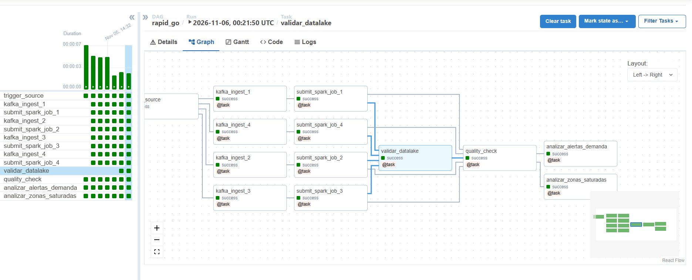
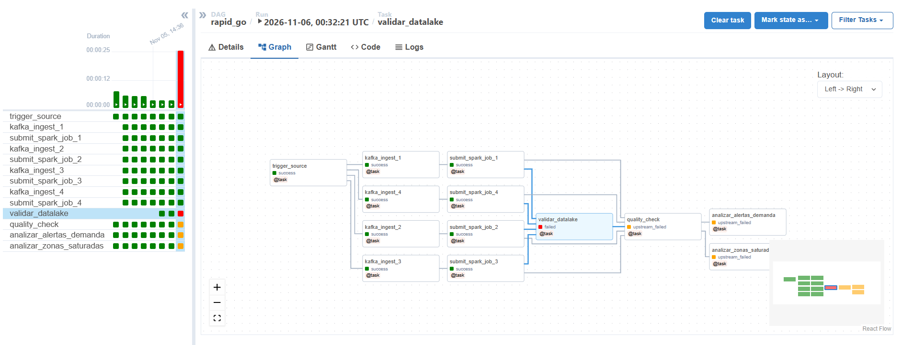
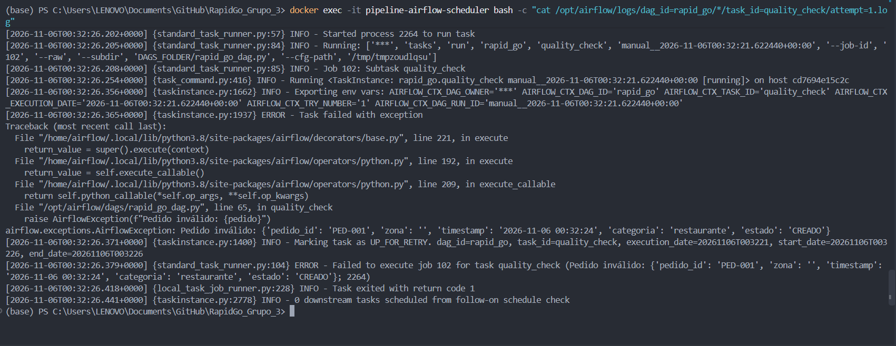
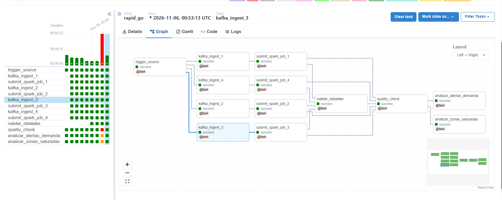

# Error 3 -- Validación de Esquema y Datos Corruptos

> *Fecha:* 2026-11-05
> *Responsable:* Luisa Valentina Rodriguez Perez
> *Objetivo:* Documentar el fallo controlado y la recuperación del pipeline cuando la ingesta recibe eventos con campos obligatorios vacíos o nulos, violando el contrato de datos.

---

## Descripción

La tarea `quality_check` en el DAG `rapid_go` implementa una verificación a nivel de fila sobre cada pedido recibido. Dicha regla exige que campos críticos como `pedido_id` y `zona` no sean nulos ni cadenas vacías, ya que la ausencia de la zona geográfica impediría calcular las ventanas de demanda y generaría errores en cascada.

Para simular este escenario de fallo, se inyectó intencionalmente un evento con el campo `"zona": ""` dentro del flujo de pedidos. La tarea de validación detectó la anomalía, arrojó una excepción de tipo `AirflowException` y detuvo el flujo del pipeline, protegiendo las etapas analíticas posteriores de procesar información inconsistente. Luego de corregir el registro con un valor zonal válido, se aplicó la acción `Clear task` en Airflow, validando que el orquestador reanudara y completara el flujo en estado `success`.

---

## Evidencias

### 1. Ejecución previa sin anomalías de esquema

El DAG ejecutaba su ciclo normal donde todos los pedidos cumplían con el contrato estructurado (`pedido_id`, `zona`, `timestamp`, `categoria`, `estado`) y todas las tareas finalizaban en `success`.

---

### 2. Fallo controlado por dato inválido en el contrato

Al procesar el registro con el campo obligatorio vacío (`"zona": ""`), la tarea `quality_check` interrumpió la ejecución (`failed`), dejando las tareas dependientes (`analizar_alertas_demanda` y `analizar_zonas_saturadas`) en estado `upstream_failed`.

#### Registro del error en los logs de Airflow:

### 3. Recuperación exitosa tras sanear el evento

Una vez corregido el registro con su zona correspondiente (`"zona": "ZONA_CENTRO"`), se utilizó la opción `Clear task` sobre `quality_check` en la interfaz de Airflow. El orquestador reevaluó los datos limpios y completó exitosamente las tareas restantes sin necesidad de reprocesar las etapas previas del pipeline.

---

## Conclusiones

- La regla de validación de campos obligatorios (`pedido_id` y `zona`) protege la lógica analítica de la Variante 5, evitando que órdenes anónimas o sin geolocalización distorsionen el conteo de demanda por cuadrante.
- El mecanismo de detención en `quality_check` actúa como barrera de contención, impidiendo que registros mal formados contaminen la capa analítica o generen excepciones en Spark.
- Se evidenció la resiliencia operativa de Apache Airflow mediante la función `Clear task`, permitiendo reanudar la orquestación a partir de la tarea corregida de forma granular y sin reiniciar todo el clúster.
